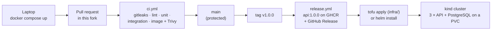

# Capstone · `JohnThunderr/turiba-devops-labs`

The course todo app, from a commit to a running cluster: Compose on a laptop, CI on every pull request, a release from a tag, and Helm on a kind cluster that OpenTofu builds.

## Run it from zero

Tested on 28 Nov 2026 in a new folder with no kind clusters, on Windows with WSL (Ubuntu) and Docker Desktop. The commands are for the Ubuntu terminal.

**You need:** Git, Docker, kind, kubectl, Helm 4 and OpenTofu 1.10 or newer.

### 1 · Get the code

```bash
git clone https://github.com/JohnThunderr/turiba-devops-labs.git
cd turiba-devops-labs
```

### 2 · The whole app with Compose

```bash
cp .env.example .env              # the example value is fine for a local run
docker compose up -d
docker compose ps                 # db, api and web are running
```

Open <http://localhost:8080> and add a todo. Then stop it:

```bash
docker compose down
```

If Compose ran on this machine before with another password, the API can't log in to the old database. `docker compose down -v` removes that volume, **and the local todos with it**.

### 3 · The cluster and the chart

Use **A** (OpenTofu) or **B** (by hand). Both make a kind cluster called `course`, so use one at a time.

**A · From code.** OpenTofu makes the cluster, the Namespace, a random database password, the Secret and the chart, so there is no Secret command.

```bash
cd infra
tofu init
tofu apply                        # type yes; the test took 2.5 minutes
cd ..
```

**B · By hand.** Replace `<choose-a-password>` with any password.

```bash
kind create cluster --name course
kubectl create namespace course
kubectl -n course create secret generic db-secret --from-literal=password='<choose-a-password>'
helm install course-app charts/course-app -n course --wait --timeout 5m
```

### 4 · Use the app on the cluster

```bash
kubectl -n course get pods        # 3 api and 1 db, all 1/1 Running
kubectl -n course port-forward service/api 8081:80
```

In a second terminal:

```bash
curl -s -X POST -H 'Content-Type: application/json' -d '{"title":"hello"}' localhost:8081/api/todos
curl -s localhost:8081/api/todos
kubectl -n course delete pod -l app=db
kubectl -n course rollout status deployment/db
curl -s localhost:8081/api/todos  # the todo is still there: it is on the PVC
```

### 5 · Upgrade and roll back (after B)

```bash
helm upgrade course-app charts/course-app -n course --set api.replicas=2 --wait
helm rollback course-app 1 -n course --wait
helm history course-app -n course
```

After path A, change the cluster only through OpenTofu, for example `tofu apply -var api_replicas=2` in `infra/`.

### 6 · Clean up

```bash
(cd infra && tofu destroy)        # after A
kind delete cluster --name course # after B
```

## Architecture



Every change starts on a branch and reaches `main` only through a pull request, and only when the five required checks are green. A tag `v1.x.y` on `main` starts `release.yml`, which builds the API image for `amd64` and `arm64`, pushes it to GHCR and creates the GitHub Release. The Helm chart in `charts/course-app/` names that exact image tag. `tofu apply` in `infra/` builds the kind cluster, creates the Namespace and the database Secret, and installs the chart. On the cluster, three API Pods sit behind one Service, and PostgreSQL keeps its data on a PVC.

## What is where

| Path | What it is |
|------|------------|
| `api/Dockerfile` | Multi-stage build of the API; runs as the user `node` |
| `web/`, `compose.yaml`, `.env.example` | The app on a laptop: `db`, `api` and `web` (nginx) |
| `.github/workflows/ci.yml` | CI on every pull request and on `main`: `gitleaks`, `lint`, `unit`, `integration`, `image` (smoke test, Trivy scan, push from `main`) |
| `.github/workflows/release.yml` | On a `v*` tag: the multi-arch image on GHCR and the GitHub Release |
| `.github/workflows/lab05-graph.yml` | Course workflow from Lab 5; only its two actions were pinned to a commit SHA |
| `.github/dependabot.yml` | Weekly update pull requests for npm, GitHub Actions and the Docker base images |
| `.gitleaksignore` | Four false positives from the history scan (public image tags), listed by commit and line |
| `k8s/` | The plain manifests of Labs 7–8, as they were before Lab 9 (image `0.2.0`), kept for those lab checks. The chart replaced them; don't deploy from here |
| `charts/course-app/` | The Helm chart: API, PostgreSQL, Services, ConfigMap, PVC |
| `infra/` | OpenTofu: the kind cluster, the Namespace, the random password, the Secret and the chart |
| `capstone/README.md` | This file |
| `lab1/`, `lab2/`, `lab4/` … `lab9/` | Lab write-ups |

**Course reference and starter files:**

- `compose.yaml` and `.github/workflows/ci.yml` began as the course starter files (Labs 4 and 5).
- The API and web code are the course app. `api/eslint.config.js` is a course file, copied as Lab 5 says; `api/test/todos.integration.test.js` is the course file with one test added.
- `api/.dockerignore` is identical to the course reference file.
- Four chart templates (`api-deployment.yaml`, `app-config.yaml`, `db-deployment.yaml`, `db-pvc.yaml`) are identical to the Lab 10 fallback chart. In this fork they were moved from the `k8s/` manifests (PR [#23](https://github.com/JohnThunderr/turiba-devops-labs/pull/23)), not copied from the fallback.

## Level and evidence

I claim **Target without T3**: Minimum (M1–M7), plus T1 and T2. T3 is under [Known issues](#known-issues).

| Item | Evidence |
|------|----------|
| M1 · Containers | [api/Dockerfile](https://github.com/JohnThunderr/turiba-devops-labs/blob/main/api/Dockerfile) · [compose.yaml](https://github.com/JohnThunderr/turiba-devops-labs/blob/main/compose.yaml) |
| M2 · Version control | [ruleset on `main`](https://github.com/JohnThunderr/turiba-devops-labs/rules/25103022) · [closed pull requests](https://github.com/JohnThunderr/turiba-devops-labs/pulls?q=is%3Apr+is%3Aclosed) |
| M3 · CI | [CI runs on `main`](https://github.com/JohnThunderr/turiba-devops-labs/actions/workflows/ci.yml?query=branch%3Amain) · [ci.yml](https://github.com/JohnThunderr/turiba-devops-labs/blob/main/.github/workflows/ci.yml) |
| M4 · Release 1.0.0 | [Release v1.0.0](https://github.com/JohnThunderr/turiba-devops-labs/releases/tag/v1.0.0) · [the image on GHCR](https://github.com/JohnThunderr/turiba-devops-labs/pkgs/container/turiba-devops-labs%2Fapi) · [the release run](https://github.com/JohnThunderr/turiba-devops-labs/actions/runs/46130873150) |
| M5 · Kubernetes with Helm | [values.yaml, `tag: "1.0.0"`](https://github.com/JohnThunderr/turiba-devops-labs/blob/main/charts/course-app/values.yaml#L4) · [PR #36](https://github.com/JohnThunderr/turiba-devops-labs/pull/36) · upgrade and rollback: step 5 above and [lab9/README.md](https://github.com/JohnThunderr/turiba-devops-labs/blob/main/lab9/README.md) |
| M6 · No secrets in Git | [gitleaks run over the whole history](https://github.com/JohnThunderr/turiba-devops-labs/actions/runs/46133554718) (started by hand with `workflow_dispatch`) |
| M7 · This file | [Run it from zero](#run-it-from-zero), tested on 28 Nov |
| T1 · Infrastructure as code | [infra/](https://github.com/JohnThunderr/turiba-devops-labs/tree/main/infra) · [PR #29](https://github.com/JohnThunderr/turiba-devops-labs/pull/29) · [PR #30](https://github.com/JohnThunderr/turiba-devops-labs/pull/30). In the test on 28 Nov, `apply` took 149 s, `destroy` 12 s and the second `apply` 84 s |
| T2 · gitleaks | [ci.yml, job `gitleaks`](https://github.com/JohnThunderr/turiba-devops-labs/blob/main/.github/workflows/ci.yml#L24) · required in the [ruleset](https://github.com/JohnThunderr/turiba-devops-labs/rules/25103022) · [PR #32](https://github.com/JohnThunderr/turiba-devops-labs/pull/32) · [PR #33: false positives](https://github.com/JohnThunderr/turiba-devops-labs/pull/33) |
| T2 · Trivy | [ci.yml, the scan step](https://github.com/JohnThunderr/turiba-devops-labs/blob/main/.github/workflows/ci.yml#L162) · [a run where it passed](https://github.com/JohnThunderr/turiba-devops-labs/actions/runs/45840158323) · [PR #34](https://github.com/JohnThunderr/turiba-devops-labs/pull/34) |
| T2 · Dependabot | [dependabot.yml](https://github.com/JohnThunderr/turiba-devops-labs/blob/main/.github/dependabot.yml) · [PR #37 by Dependabot, closed with a reason](https://github.com/JohnThunderr/turiba-devops-labs/pull/37) |
| T2 · SHA pins | [ci.yml](https://github.com/JohnThunderr/turiba-devops-labs/blob/main/.github/workflows/ci.yml) · [release.yml](https://github.com/JohnThunderr/turiba-devops-labs/blob/main/.github/workflows/release.yml) · [PR #31](https://github.com/JohnThunderr/turiba-devops-labs/pull/31) |

## When it breaks

The three faults most likely on this cluster. Each was made to happen on 28 Nov.

| Fault | What you see | The command that shows the cause |
|-------|--------------|----------------------------------|
| The image tag doesn't exist on GHCR (a typo, or the release failed) | A new API Pod in `ImagePullBackOff` while the old ones keep answering; Helm still says `deployed` | `kubectl -n course get events --field-selector type=Warning` shows `Failed to pull image` with `NotFound`. Fix: `helm rollback course-app -n course` |
| The database is down | `GET /api/todos` answers 500, but `/healthz` answers 200 and the API Pods stay `1/1 Running` | `kubectl -n course get endpoints db` shows `<none>`; `kubectl -n course logs -l app=api -c api --tail=20` shows `GET /api/todos failed: connect ECONNREFUSED` |
| The Secret `db-secret` is missing (the step was skipped, or it was deleted) | A new database Pod in `CreateContainerConfigError` | `kubectl -n course describe pod -l app=db` ends with `secret "db-secret" not found`. Fix: create it again **with the same password** (after path A: `tofu apply`) |

## Extension

None. I don't claim Excellent.

## Known issues

- **T3 is not done.** There is no finished monitoring dashboard in this repository, and I don't claim it.
- **The API's readiness probe doesn't check the database.** It calls `/healthz`, so with PostgreSQL down the Pods stay ready while requests fail (second fault above). A readiness path that queries the database would fix it; that needs a new release.
- **Three Dependabot pull requests are open** (#38, #39, #40). They change files under `api/`, so merging one needs a new release.
- **The first Compose build in a fresh clone failed once** (`frontend grpc server closed unexpectedly`) while the laptop was busy downloading images. Running the command again worked.
- **The `web` front end runs only in Compose,** not on the cluster.

## AI use

Claude Code (an AI agent) did most of the technical work in this fork and ran the commands on my laptop at my request: Labs 6–9 including their write-ups, `infra/`, the security gates, the chart change for 1.0.0, the release tag, the from-zero tests and this file.
I switched GitHub Actions and Dependabot on, added the Dependabot secret, and approved the release tag and the branch rule change.
