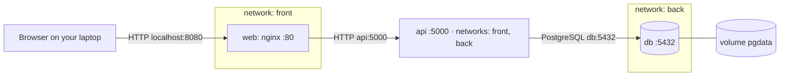

# Lab 4 · Multi-service app with Compose

GitHub user: <johnthunderr> · Reference files used (Lab 2 fallback): no

<!-- Keep every heading as it is: the grader finds the sections by name. Fill in every blank (four underscores) and your GitHub user name: check.sh writeup flags anything left. -->

## 1 · Architecture



Which arrow crosses from your laptop into Docker: B --> W

## 2 · Predictions and what happened

Part 1: fill in "I predicted" (the letter and a one-line reason) before you write any YAML. Part 3: fill in the rest. A wrong prediction that you explain earns full marks.

| # | I predicted | What I saw (command → the deciding output line) | Match? | If not: why |
|---|-------------|--------------------------------------------------|--------|-------------|
| P1 | B - web does not see the DB, since db sits in back, but web can only see front | thunder@BSW:~/turiba-devops-labs$ docker compose exec web getent hosts db -> No output | Yes | |
| P2 | B - while port 5432 is used by PostgreSQL, it is used within the container, and by sending request from outside the container, the request gets refused by OS| Db can be reached from web, but refused if accessed directly | Yes | |
| P3 | A - down only removes the database, not the volume where todo sits | after docker up, I got the message 'survived' | Yes | |
| P4 | C - the same as P3, but in this case -v removes the volume also | docker compose up -d --wait
curl -s localhost:8080/api/todos ERROR:  relation "todos" does not exist, SO yes, it deletes both db and volumes and nothing comes back up | Yes | |
| P5 | A - health check only tests /healthz, which doesn’t use the database, so it stays healthy, the stopped db fails inside the API, which answers 500.| I see 2 services at the beginning app-api and app-web, and afterwards just app-api with status healthy. | Yes | |
| P6 | B - app.js runs in browser not in Docker; the laptop isn’t on any Docker network, so it can’t resolve the name api. The lookup fails before CORS could even apply.| even web can’t resolve names outside its networks; my browser runs app.js on the laptop, which is on no Docker network, so api can’t be resolved | Yes | |

## 3 · Backup and restore

```
thunder@BSW:~/turiba-devops-labs$ curl -s -X POST localhost:8080/api/todos -H 'Content-Type: application/json' -d '{"title":"johnthunderr: survive me"}'
{"id":5,"title":"johnthunderr: survive me","done":false,"created_at":"2026-10-19T09:34:59.314Z"}thunder@BSW:~/turiba-devops-labs$ mkdir -p backup
thunder@BSW:~/turiba-devops-labs$ docker compose exec -T db pg_dump -U todo -d todo > backup/todo.sqllume
thunder@BSW:~/turiba-devops-labs$
thunder@BSW:~/turiba-devops-labs$ curl -s -X POST localhost:8080/api/todos -H 'Content-Type: application/json' -d '{"title":"johnthunderr: survive me"}'
{"id":6,"title":"johnthunderr: survive me","done":false,"created_at":"2026-10-19T09:47:20.275Z"}thunder@BSW:~/turiba-devops-labs$ mkdir -p backup
thunder@BSW:~/turiba-devops-labs$ docker compose exec -T db pg_dump -U todo -d todo > backup/todo.sqln: service_started
thunder@BSW:~/turiba-devops-labs$
thunder@BSW:~/turiba-devops-labs$
thunder@BSW:~/turiba-devops-labs$
thunder@BSW:~/turiba-devops-labs$
thunder@BSW:~/turiba-devops-labs$
thunder@BSW:~/turiba-devops-labs$
thunder@BSW:~/turiba-devops-labs$
[+] down 6/6~/turiba-devops-labs$ curl -s -X POST localhost:8080/api/todos -H 'Conten
 ✔ Container course-app-web-1 Removed                                            0.6s
 ✔ Container course-app-api-1 Removed                                            0.5s
 ✔ Container course-app-db-1  Removed                                            0.5s
 ✔ Network course-app_back    Removed                                            0.3s
 ✔ Volume course-app_pgdata   Removed                                            0.1s
 ✔ Network course-app_front   Removed                                            0.5s
thunder@BSW:~/turiba-devops-labs$ docker compose up -d --wait db
[+] up 3/3W:~/turiba-devops-labs$
 ✔ Network course-app_back   Created                                             0.1s
 ✔ Volume course-app_pgdata  Created                                             0.0s
 ✔ Container course-app-db-1 Healthy                                             6.1s
thunder@BSW:~/turiba-devops-labs$ tle":"johnthunderr: survive me"}'
thunder@BSW:~/turiba-devops-labs$ vive me","done":false,"created_at":"2026-10-19T09:4
thunder@BSW:~/turiba-devops-labs$ docker compose exec db psql -U todo -d todo -c 'select count(*) from todos'ops-labs$ docker compose exec -T db pg_dump -U todo -d todo >
ERROR:  relation "todos" does not exist
LINE 1: select count(*) from todosgrep 'survive me' backup/todo.sql
                             ^  f       2026-10-19 07:08:21.554075+00
thunder@BSW:~/turiba-devops-labs$ docker compose exec -T db psql -U todo -d todo < backup/todo.sqlhunderr: survive me        f       2026-10-19 09:34:59.314101+00
SET namejohnthunderr: survive me        f       2026-10-19 09:47:20.275357+00
SETnder@johnthunderr: survive me        f       2026-10-19 09:47:38.020687+00
SET1 ✔ pjohnthunderr: survive me        f       2026-10-19 09:47:49.362701+00
SETnder@BSW:~/turiba-devops-labs$ docker compose down -vapp's address
SET3 ✔ passed  · hints used: 0 · web can't find the API
SET4 ✔ passed  · hints used: 0 · The page loads, the list stays empty
 set_config et · hints used: 0 · Todos disappear
------------et · hints used: 0 · The first start fails
  c7 · not yet · hints used: 0 · db stops right after it starts
(1 row)not yet · hints used: 0 · Stretch: the password was rotated

SET of c2–c7 passed (4 needed).
SETnder@BSW:~/compose-clinic/c5$ docker compose up -d --wait
SET
SET
SET
SET
CREATE TABLE
ALTER TABLE
CREATE SEQUENCE
ALTER SEQUENCE
ALTER SEQUENCE
ALTER TABLE
COPY 7
 setval
--------
      8
(1 row)

ALTER TABLE
thunder@BSW:~/turiba-devops-labs$ docker compose up -d --wait
[+] up 4/4
 ✔ Container course-app-db-1  Healthy                                            2.3s
 ✔ Network course-app_front   Created                                            0.1s
 ✔ Container course-app-api-1 Healthy                                            6.7s
 ✔ Container course-app-web-1 Healthy                                            2.1s
thunder@BSW:~/turiba-devops-labs$ curl -s localhost:8080/api/todos
[{"id":2,"title":"<you>: survive me","done":false,"created_at":"2026-10-19T07:08:21.554Z"},{"id":3,"title":"<you>: survive me","done":false,"created_at":"2026-10-19T07:13:21.721Z"},{"id":4,"title":"asdasd","done":false,"created_at":"2026-10-19T08:34:46.783Z"},{"id":5,"title":"johnthunderr: survive me","done":false,"created_at":"2026-10-19T09:34:59.314Z"},{"id":6,"title":"johnthunderr: survive me","done":false,"created_at":"2026-10-19T09:47:20.275Z"},{"id":7,"title":"johnthunderr: survive me","done":false,"created_at":"2026-10-19T09:47:38.020Z"},{"id":8,"title":"johnthunderr: survive me","done":false,"created_at":"2026-10-19T09:47:49.362Z"}]t```

Why the restore must run before `api` starts: APi creates a new table if none exist. Since restore has tables to restore, it has to run before the new table is created and locks it out of restoring he old one.

## 4 · Compose clinic

### c1 (worked example)
- Error line (copied): `connect ECONNREFUSED 127.0.0.1:5432`
- Checkpoint: port, inside `api`
- Fix: `DB_HOST: db`
- Why this fix, and not the tempting one: inside `api`, `localhost` is `api` itself, and nothing listens on 5432 there. Docker's DNS answers `db` with the database container's address. Publishing `db`'s port would "work" by opening a door into the database.
- Hints used: 0

<!-- Copy the block below once for every mission you solved and change cN to c2, c3 … Then delete the cN block itself. -->

### c2
- Committed fix: `lab4/clinic/c2/`
- Error line (copied): * Failed to connect to localhost port 8102 after 0 ms: Could not connect to server
- Checkpoint (name / path / port / app / config / data): port
- Fix: `ports: "8102:3000"` (was `"3000:8102"`)
- Why this fix, and not the tempting one:  `ports` is `HOST:CONTAINER`. `docker compose ps` showed `0.0.0.0:3000->8102/tcp`, so laptop 3000 led to container 8102, and nothing published 8102 on the laptop. nginx listening on 3000 inside (set by the mounted `nginx.conf`), so the correct mapping is laptop 8102 → container 3000.
- Hints used: 0

### c3
- Committed fix: `lab4/clinic/c3/`
- Error line (copied): host not found in upstream "api"
- Checkpoint (name / path / port / app / config / data): name
- Fix: api on networks: [front, back] (it was only on back)
- Why this fix, and not the tempting one: Docker’s DNS only resolves services on a shared network, and web (front) and api (back) shared none. api is the go-between, so it belongs on both.
- Hints used: 0

### c4
- Committed fix: `lab4/clinic/c4/`
- Error line (copied): GET http://api:5000/api/todos net::ERR_NAME_NOT_RESOLVED
- Checkpoint (name / path / port / app / config / data): name
- Fix: const API = '/api/todos'; (was 'http://api:5000/api/todos')
- Why this fix, and not the tempting one: app.js runs in the browser on the laptop, which isn’t on any Docker network, so it can’t resolve api.
- Hints used: 0

### c5
- Committed fix: `lab4/clinic/c5/`
- Error line (copied): `[]` (`curl -s localhost:8105/api/todos` after `docker compose down` and `up -d`: the todo I had added was gone)
- Checkpoint (name / path / port / app / config / data): data
- Fix: added `volumes: - pgdata:/var/lib/postgresql/data` to `db`
- Why this fix, and not the tempting one: `db` had no named volume, so PostgreSQL's data lived with the container, and `down` removed it. A named volume exists independently of the container and is reattached at the same path on every `up`, so the data survives. 
- Hints used: 0

## 5 · Run in one command

```bash
git clone https://github.com/johnthunderr/turiba-devops-labs.git && cd turiba-devops-labs
cp .env.example .env
docker compose up -d --wait
```

## 6 · Answers

### A1
In c1 the API logged `ECONNREFUSED 127.0.0.1:5432`. Which container was `127.0.0.1`, and why does `db` work instead?

127... is a localhost. db works because it’s the service name on the shared back network
____

### A2
Trace `POST /api/todos` from your browser to PostgreSQL: each hop, with the name and port used. Why does `db` have no `ports:`?

The browser sends POST /api/todos to localhost:8080, the only published port, which Docker forwards to nginx in web on port 80. nginx matches /api/ and forwards the request via proxy_pass to api:5000 over the front network. The API then queries PostgreSQL at db:5432 over the back network

db has no ports: because only api needs it, from inside Docker; publishing it would open the database to anything that can reach my laptop
____

### A3
`docker compose down` kept your todos, and `docker compose down -v` deleted them. Where were they stored, and what exactly does `-v` remove?

The todos were stored in the named volume pgdata,  outside the container’s own filesystem. docker compose down removes the containers and networks but keeps volumes, so the new db container reattached the same data. -v additionally removes the project’s named volumes, so the data was deleted, and even the todos table was gone.
____

### A4
With `db` stopped, `docker compose ps` showed `api` as healthy, but `/api/todos` answered 500. Explain both. What does `service_healthy` protect against, and what not?

api stayed healthy because its health check only calls /healthz, which tests that the process answers, without touching the database. /api/todos needs the database, so with db stopped the query failed inside the API, which answered 500. service_healthy protects the start order: api starts only after db passes its health check. It doesn’t protect against db failing later, because Compose neither stops nor restarts api when db goes down.
____
